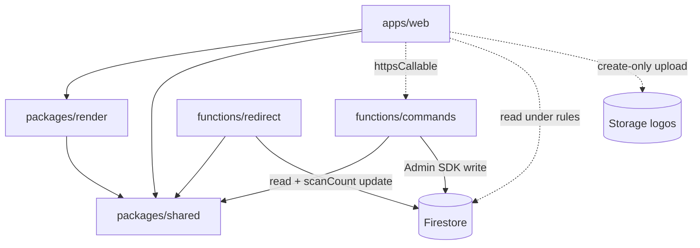
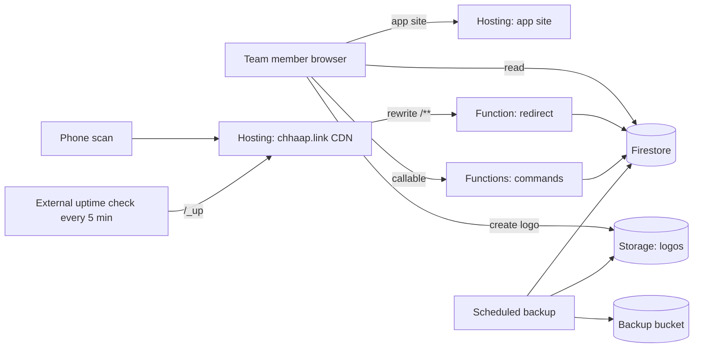
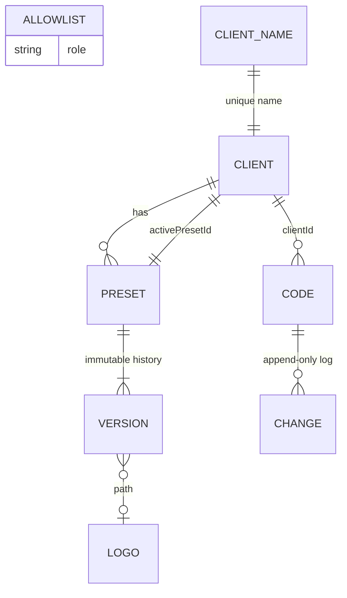

# Architecture Spine — Chhaap

## Design Paradigm

**CQRS-lite on Firebase with a shared functional render core.**

- **Queries:** the Vue app reads Firestore directly, gated by security rules.
- **Commands:** every data write goes through a callable Cloud Function. Rules deny all client writes to Firestore.
- **Render core:** one pure module (`packages/render`) draws, checks and exports codes. The same module drives the preview, the scan check and the exports.
- **Public edge:** the redirect function on `chhaap.link` reads codes and bumps their scan count. It writes nothing else.

| Layer | Lives in | May import |
| --- | --- | --- |
| Shared kernel (types, zod schemas, slug, URL validator, `RENDERER_VERSION`, `isExportable`) | `packages/shared` | nothing app-specific |
| Render core (draw, scanCheck, exportPng, exportPdf) | `packages/render` | `shared` |
| Web app (UI, queries, command calls) | `apps/web` | `shared`, `render` |
| Command functions | `functions/src/commands` | `shared` |
| Redirect function | `functions/src/redirect` | `shared` |



## Invariants & Rules

### AD-1 — Hybrid split: the browser checks, functions commit [ADOPTED]

- **Binds:** FR-3–FR-9, FR-12, FR-14, NFR-1
- **Prevents:** writes that skip the change log or preset history, and two places that each think they own validation.
- **Rule:** Every Firestore write from a team member goes through a callable command in `functions/src/commands`. `firestore.rules` sets `write: if false` on every path. The only client write is a logo upload to Storage (AD-6, AD-8). Commands accept a scan result attested by the browser and never draw or decode. They only accept results that satisfy AD-5.

### AD-2 — One render module for preview, check and export [ADOPTED]

- **Binds:** FR-4, FR-5, FR-12, FR-14
- **Prevents:** a code passing the check through one drawing path and being exported through another.
- **Rule:**
  - Only `packages/render` imports `qr-code-styling`, `zxing-wasm`, `jspdf` or `svg2pdf.js`.
  - It exposes `draw`, `scanCheck`, `exportPng` and `exportPdf`. Each takes a *resolved* preset, whose logo is already a data URI, never a Storage URL.
  - Error correction is level H whenever a logo is present.
  - The quiet zone is 4 modules on every side of every raster and export.
  - The `zxing-wasm` reader file is self-hosted with the app, never fetched from a CDN, and the reader runs with `formats: ['QRCode']`.
  - `RENDERER_VERSION` lives in `packages/shared`. It is bumped on any upgrade of the four libraries above.
  - A test must pass that exports a PDF, rasterises it and runs `scanCheck` on the result.

### AD-3 — The scan-check pass criterion [ADOPTED]

- **Binds:** FR-12, FR-6, FR-4, FR-9
- **Prevents:** different screens judging "passed" differently.
- **Rule:** A code passes only if `zxing-wasm` decodes a string exactly equal to `https://chhaap.link/<slug>` from **both** a 2000 px raster and a 160 px raster, each drawn by `draw()`. The only failure reasons are `no-read` and `wrong-link`.

### AD-4 — Codes are keyed by slug [ADOPTED]

- **Binds:** FR-6, FR-9, FR-10, NFR-7
- **Prevents:** two owners of slug uniqueness, and a slug index drifting from its code.
- **Rule:**
  - A code lives at `codes/{slug}`, with `clientId` as a field.
  - Slugs come only from `shared/slug.ts`: 5 characters from an alphabet without `0 O 1 l I`. That file also exports `SLUG_REGEX`.
  - The browser proposes a slug and checks it. `createCode` creates the document in a transaction and returns `already-exists` on a collision. The browser then retries with a fresh slug, up to three times when the check fails.
  - Code documents are never deleted, and a slug is never reassigned.

### AD-5 — Commands that carry scan results are serialised on the preset

- **Binds:** FR-4, FR-6, FR-9, FR-12
- **Prevents:** a code created or unarchived during a preset save escaping the re-check, and a stale or failing browser result being saved.
- **Rule:** This applies to `createCode`, `savePreset`, `restorePreset` and `setStatus` when a code leaves the archive.
  - Each of these commands reads the client's active preset document inside its transaction.
  - The input carries the `baseVersion` the browser checked against. The command rejects it with `failed-precondition` unless `baseVersion` equals `currentVersion`.
  - Every result must be `passed: true` and carry the current `RENDERER_VERSION`. Anything else is rejected.
  - `savePreset` and `restorePreset` always write the preset document, setting `currentVersion` to `baseVersion + 1`.
    - Their results must cover exactly the client's non-archived codes, as read in the transaction.
    - In the same transaction they write each of those codes' `scanResult`, stamped with the new version.
  - A stored `scanResult` is `{passed, reason?, presetId, presetVersion, rendererVersion, checkedAt}`. The server stamps `presetVersion` and `checkedAt`.

### AD-6 — Presets are versioned and logos are immutable [ADOPTED]

- **Binds:** FR-3, FR-4, FR-5, NFR-7
- **Prevents:** a restore pointing at an overwritten logo, two owners of a client's first preset, and two different models of preset history.
- **Rule:**
  - `createClient` creates three things in one transaction: the client, its first preset at `clients/{clientId}/presets/{presetId}` (version 1, default settings, no logo), and `activePresetId`. `savePreset` never creates a preset.
  - Preset history is the immutable documents under `.../versions/{n}`. Saving or restoring a preset always appends version n+1. A restore copies an old version's settings.
  - Logos are created at `logos/{clientId}/{uuid}.{png|svg}` and are never overwritten or deleted.
  - `savePreset` rejects a logo path outside its client's folder.

### AD-7 — Audit records are written in the same transaction as the change

- **Binds:** FR-4, FR-7, FR-9
- **Prevents:** a change being saved without its log entry, and log entries being edited.
- **Rule:**
  - A command that changes a code's destination or status writes a `codes/{slug}/changes/{autoId}` document `{by, at, field, old, new}` in the same transaction as the change.
  - Preset versions (AD-6) are the preset history.
  - No command updates or deletes a change or a version.
  - Renames aren't logged (FR-8).

### AD-8 — Access is the allowlist, checked on every request, in every rule set

- **Binds:** FR-1, FR-2, FR-5, NFR-1
- **Prevents:** Firestore rules, Storage rules and functions disagreeing about who is a team member.
- **Rule:**
  - The team is the set of `allowlist/{lowercased email}` documents, each holding `role: owner|member`. There is exactly one owner.
  - `isTeam()` means `request.auth` is set, `email_verified` is true and `allowlist/<token email lowercased>` exists.
  - **Firestore rules:** reading anything requires `isTeam()`. Each user may read their own allowlist document, so the app can show "not authorised" or owner-only screens. Only the owner can read the other allowlist documents.
  - **Storage rules:**
    - `logos/{clientId}/{file}` allows `create` only, when `firestore.exists` confirms `isTeam()`, the content type is `image/png` or `image/svg+xml`, and the file is 2 MB or less.
    - Reads require `isTeam()`.
    - There is no update or delete.
  - The bucket's CORS config is kept in the repo.
  - **Commands:** every command first runs `assertTeamMember()`, and allowlist commands also run `assertOwner()`. Both live in `functions/src/auth.ts`. Custom claims aren't used, so removing someone takes effect on their next request.

### AD-9 — The redirect is a separate, cached edge with a narrow write

- **Binds:** FR-10, FR-11, NFR-2, NFR-3, OPS-2
- **Prevents:** the public surface creating or corrupting data, and scan counts silently lost to CPU throttling.
- **Rule:**
  - `chhaap.link` is its own Hosting site. It rewrites `/**` to one 2nd-gen function, `redirect`, which allows unauthenticated invocation.
  - A path that isn't `/_up` and doesn't match `SLUG_REGEX` returns the not-found page without reading Firestore.
  - Otherwise the function reads `codes/{slug}`:
    - **Active code:** a 302 to its destination.
    - **Paused or archived code:** the inactive-code page. It never names the client.
    - **Missing slug:** the not-found page.
    - All three responses carry `Cache-Control: public, max-age=0, s-maxage=60`.
  - For an existing code, the function runs `update({scanCount: FieldValue.increment(1)})` and waits for it, for at most about 200 ms, **before** responding. It never uses `set()`. Failures are logged and never block the response.
  - `/_up` reads `system/monitor`, is never counted, and is sent with `no-store`.
  - Scans the CDN serves from cache aren't counted, so the count is approximate.
  - `minInstances` is 0. The OPS-2 monitor pings `/_up` every 5 minutes, which also keeps an instance warm.
  - The redirect bundle imports only `firebase-admin/firestore` and `packages/shared`, and starts lazily.

### AD-10 — One region, one project, Blaze with a budget alert

- **Binds:** NFR-3, NFR-5, OPS-4
- **Prevents:** functions, Firestore and Storage being spread across regions, and tests touching production.
- **Rule:**
  - One production Firebase project on the Blaze plan, with a budget alert of about $5 a month.
  - Functions, Firestore and Storage all use `europe-west1`.
  - Local development, CI and every test run against the Emulator Suite, never against production.

### AD-11 — One gate decides what can be downloaded

- **Binds:** FR-12, FR-14, SM-1
- **Prevents:** a code being exported in a preset or renderer it was never checked against, such as a stale archived code or every code after a library upgrade.
- **Rule:**
  - `isExportable(code, preset)` in `packages/shared` is the only download gate. It is true only when all of these hold:
    - the code isn't archived;
    - `scanResult.passed` is true;
    - `presetId` equals the client's `activePresetId`;
    - `presetVersion` equals `currentVersion`;
    - `rendererVersion` equals `RENDERER_VERSION`.
  - If the renderer version is out of date, the UI offers to re-check by re-saving the current preset, which goes through AD-5.

### AD-12 — Each code field has one writer

- **Binds:** FR-6–FR-11
- **Prevents:** two commands, or a command and the redirect, writing the same field.
- **Rule:** These are the only writers of `codes/{slug}`:

| Field | Writer |
| --- | --- |
| `clientId`, `createdAt`, `createdBy` | `createCode`, once |
| `name` | `createCode`, `renameCode` |
| `destination` | `createCode`, `setDestination` |
| `status` | `createCode` (as `active`), `setStatus` |
| `scanResult` | `createCode`, `savePreset`, `restorePreset`, `setStatus` (leaving the archive) |
| `scanCount` | `createCode` (as `0`), `redirect` (increment only) |

## Consistency Conventions

| Concern | Convention |
| --- | --- |
| Collections | `allowlist`, `clientNames`, `clients`, `clients/{id}/presets`, `.../versions`, `codes`, `codes/{slug}/changes`, `system`. Field names in camelCase. |
| IDs | Clients and presets use Firestore auto IDs. Codes use the slug. Versions use the integer as a string. Allowlist documents use the lowercased email. `clientNames` documents use the lowercased client name. |
| Client names | Unique ignoring case. `createClient` and `renameClient` own `clientNames/{lowercased name}`, written in the same transaction as the client. |
| Timestamps | Firestore `serverTimestamp()`, set by commands only. Fields are `createdAt`/`createdBy`, and `by`/`at` in logs. Actor = verified email. |
| Code status | `active` \| `paused` \| `archived`. No other values. No deletion. |
| Commands | `createClient`, `renameClient`, `savePreset`, `restorePreset`, `createCode`, `renameCode`, `setDestination`, `setStatus`, `addTeamMember`, `removeTeamMember`. Each input is validated against a zod schema in `packages/shared`. The web app imports the same schema. |
| Errors | Commands throw `HttpsError` using `invalid-argument`, `permission-denied`, `failed-precondition` (stale version, set mismatch or failing result), `already-exists` (slug or client name) or `not-found`. The UI maps these codes to messages. |
| URLs | Destinations must be absolute `http`/`https` URLs, checked by the shared validator on both sides. |
| Export file names | `<client>-<code name>.<pdf|png>`, slugified. |
| Tests | Rules tests with `@firebase/rules-unit-testing`. Command tests run against the emulators. Render tests run in a real browser (Playwright), because `qr-code-styling` needs a DOM. |

## Stack

| Name | Version |
| --- | --- |
| Node.js (Functions runtime `nodejs24`; dev and CI) | 24 (dev/CI ≥ 24.12) |
| TypeScript | ~6.0 (create-vue default) |
| vue-tsc | 3.3.14 |
| Vue (via create-vue) | 3.5.45 (create-vue 3.24.0) |
| Vite | 8.3.7 |
| Vue Router / Pinia | 5.5.0 / 4.1.0 |
| zod | 4.6.7 |
| firebase (web SDK) | 13.2.0 |
| firebase-functions / firebase-admin | 7.4.0 / 14.5.0 |
| firebase-tools | 15.35.0 |
| qr-code-styling | 1.9.2 (last published 2025-04; fork risk per OPS-3) |
| zxing-wasm | 3.1.6 |
| jspdf / svg2pdf.js | 4.2.1 / 2.9.0 |
| Vitest / @firebase/rules-unit-testing | 5.1.0 / 6.0.0 |
| Playwright | 1.65.0 |

## Structural Seed





```text
apps/web/              # Vue 3 SPA (create-vue): views, Pinia stores, command callers
packages/shared/       # types, zod schemas, slug + SLUG_REGEX, URL validator, RENDERER_VERSION, isExportable
packages/render/       # draw / scanCheck / exportPng / exportPdf; self-hosted zxing wasm
functions/src/
  commands/            # one file per callable command
  redirect/            # chhaap.link edge function
  auth.ts              # assertTeamMember / assertOwner
firestore.rules
storage.rules
storage.cors.json
firebase.json          # two Hosting sites: app, link
```

## Capability → Architecture Map

| Capability / Area | Lives in | Governed by |
| --- | --- | --- |
| Sign-in, allowlist (FR-1, FR-2) | `apps/web`, `functions/src/auth.ts`, `firestore.rules` | AD-8 |
| Clients, presets, logos (FR-3–FR-5) | `createClient`, `renameClient`, `savePreset`, `restorePreset`; Storage | AD-1, AD-5, AD-6, AD-7, AD-8 |
| Create code, scan check (FR-6, FR-12) | `packages/render` + `createCode` | AD-2, AD-3, AD-4, AD-5 |
| Destination, rename, status (FR-7–FR-9) | `setDestination`, `renameCode`, `setStatus` | AD-5, AD-7, AD-12 |
| Redirect, scan count (FR-10, FR-11) | `functions/src/redirect` | AD-9, AD-12 |
| Library, export (FR-13, FR-14) | `apps/web` queries + `packages/render` exports | AD-2, AD-11 |
| v2 client portal readiness (NFR-7) | `codes.clientId`, `clients/{id}/presets` | AD-4, AD-6 |
| Region, cost (NFR-3, NFR-5) | Firebase project config | AD-9, AD-10 |
| Monitoring, backups (OPS-2, OPS-4) | `/_up` path; scheduled export | AD-9, Deferred |

## Open Questions

- **Does the Hosting CDN cache 302 responses that carry `s-maxage`?** The docs don't say. If it doesn't, redirects stay correct but are never cached. Verify in the redirect epic.
- **Does `firebase deploy` accept the `nodejs24` runtime?** Google's runtime page supports it until 2028, but Firebase's own page lists only Node 20 and 22. Confirm at the first deploy. If it doesn't, fall back to `nodejs22`, which is deprecated from 2027-04-30.

## Deferred

- **Renderer upgrade re-check.** The UI and trigger for "re-check all" (re-save every client's current preset after a `RENDERER_VERSION` bump) are decided at epic level. AD-5 and AD-11 already fix how it behaves.
- **Backup mechanism (OPS-4).** Choose between Firestore scheduled backups and a scheduled managed export, plus a copy of the logos bucket, when the ops epic is built. Weekly cadence.
- **Staging environment.** v1 uses the Emulator Suite only. Revisit if a deploy breaks production.
- **CI/CD pipeline.** GitHub Actions deploy versus manual `firebase deploy` is an epic-level choice. Rules, command and render tests run on every PR either way.
- **App domain.** The app site can stay on `*.web.app` or move to a custom subdomain. Either works.
- **Bot filtering on the scan count** is out of scope for v1 (PRD FR-11).
- **UI component library and styling.** Left to the UX work.
- **Owner setup tasks:** upgrade to Blaze and set the budget alert, make the one-time IAM grant that lets Storage rules call Firestore, apply the bucket CORS config, and point the `chhaap.link` DNS at Hosting.
